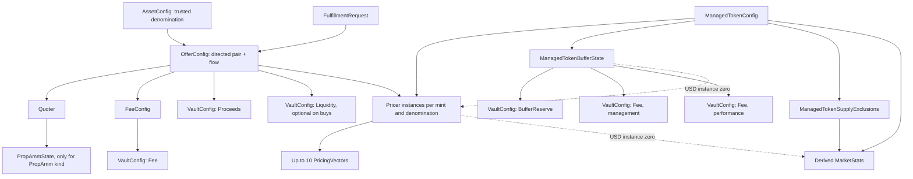

# EVM-aligned Solana model

Status: reusable configuration creation is implemented in
[`instructions/configuration/`](../programs/onreapp/src/instructions/configuration/mod.rs),
using the layouts in [`model/`](../programs/onreapp/src/model/mod.rs).
Existing trading, pricing-vector updates, reporting, BUFFER accrual, token routing,
and custody still use the legacy accounts. The new accounts are not a migration
or a new settlement path. This document describes the target model; the current
runtime model remains documented in [`DOMAIN_MODEL.md`](DOMAIN_MODEL.md).

The reference is the current `onre-evm` checkout:
`src/types/OnReTypes.sol`, `src/diamond/LibOnReStorage.sol`,
`src/libraries/OnReIds.sol`, and `docs/OFFER_ARCHITECTURE.md`.
The model follows those domain relationships rather than copying Diamond storage
or ERC-20 token mechanics onto Solana.

Offers explicitly select a compatible Pricer. This differs from EVM's token-derived
offer pricing: multiple Pricer instances may price the same managed mint in the
same denomination, and each offer stores the chosen Pricer's address.

## Relationships

An offer combines reusable components. It does not own vectors, fee policy,
Prop AMM pressure, or BUFFER accounting. Different managed mints have independent
pricing, supply exclusions, issuance limits, and BUFFER state. Governance remains
the existing boss/admin/worker/approver model; Solana program upgrades remain under
the loader upgrade authority, rather than introducing Diamond roles or facets.

## Layout mapping

All accounts use normal Anchor/Borsh serialization, not `repr(C)` or zero-copy.
Field order in each domain module defines the proposed serialized layout. `INIT_SPACE`
excludes the eight-byte account discriminator. There is no implicit padding.

The model is split into `pricer`, `quoter`, `prop_amm`, `fee`, `vault`, `offer`,
`buffer`, `fulfillment`, `managed_token`, `asset`, `supply_exclusions`, and `market_stats`
modules. Each module owns its domain's account and supporting types. `model/mod.rs`
re-exports the types, preserving existing `model::Pricer`-style imports alongside
the domain paths such as `model::pricer::Pricer`.

| Account | Body bytes | Allocated bytes with discriminator |
| --- | ---: | ---: |
| ManagedTokenConfig | 51 | 59 |
| AssetConfig | 35 | 43 |
| Pricer | 444 | 452 |
| Quoter | 11 | 19 |
| PropAmmState | 183 | 191 |
| FeeConfig | 52 | 60 |
| VaultConfig | 44 | 52 |
| ManagedTokenBufferState | 166 | 174 |
| OfferConfig | 230 | 238 |
| FulfillmentRequest | 89 | 97 |
| ManagedTokenSupplyExclusions | 674 | 682 |

| EVM object | Solana model | Contents |
| --- | --- | --- |
| ManagedTokenConfig | ManagedTokenConfig | Managed mint, decimals, enabled, program issuance limits, bump. |
| Supported-asset denomination | AssetConfig | External mint, boss-attested denomination, enabled, bump. |
| PricingVector | PricingVector, embedded | Start/base times, base price, APR, price-step duration. |
| Pricer | Pricer | Instance ID, managed mint, denomination, 10 vectors, active count, enabled, bump. |
| Quoter | Quoter | Kind, instance ID, enabled, bump. |
| PropAmmState | PropAmmState | Parent quoter, bound asset/managed pair, embedded config, rolling volumes, epoch, sell count, bump. |
| FeeConfig | FeeConfig | Instance ID, Fee vault reference, basis points, minimum input fee, enabled, bump. |
| ConfigurableVault | VaultConfig | Kind, instance ID, withdrawal destination, refill target, bump. |
| BufferState | ManagedTokenBufferState | Managed mint, three vault references, supply baseline, watermark, accrual time, APR, fee settings, bump. |
| OfferConfig | OfferConfig | Directed mint pair, flow, direction, pricer/quoter/fee/proceeds/liquidity references, decimals, enabled, bump. |
| FulfillmentRequest | FulfillmentRequest | Offer, user, numeric request ID, gross input, fulfilled gross input, bump. |
| Excluded-supply mappings | ManagedTokenSupplyExclusions | Managed mint, up to 20 token-account addresses, active count, bump. |
| MarketStats | MarketStats, derived value | Managed mint, APY, circulating supply, NAV, NAV adjustment, TVL, timestamp, slot. |

`VaultConfig` and `ManagedTokenBufferState` deliberately have different Rust names
from the legacy `ConfigurableVault` and `BufferState`. Anchor discriminators are
derived from struct names, not Rust module paths. Reusing those names in another
module would make incompatible account bodies share a discriminator.

An account's existence and ownership replace EVM mapping `exists` flags. The
configurable executable records retain EVM's positive `enabled` polarity:
managed tokens, assets, pricers, quoters, fee configs, and offers. Creation
explicitly enables them. BUFFER existence is optional; Prop AMM configuration
exists when its pair-state account exists. Neither is implied by zero-filled data.

## Account identities

Creation instructions use these identities from `model::seeds`.
Fulfillment requests and supply exclusions remain model-only identities.
Each PDA starts directly with its domain seed; there is no shared prefix.
The concatenated seed layouts are disjoint from legacy layouts and one another,
including when variable seed bytes are arbitrary. Legacy derivations are unchanged.
Pubkey references store the actual component PDA, replacing EVM `bytes32` IDs.
Enum seed values use their one-byte Borsh ordinal;
numeric instance and request IDs use eight-byte little-endian encoding.

| Object | Ordered PDA seeds |
| --- | --- |
| ManagedTokenConfig | `"managed_token", managed_mint` |
| AssetConfig | `"asset", asset_mint` |
| Pricer | `"pricer", managed_mint, denomination, instance_id` |
| Quoter | `"quoter", kind, instance_id` |
| PropAmmState | `"prop_amm", quoter` |
| FeeConfig | `"fee_config", instance_id` |
| Ordinary VaultConfig | `"vault", kind, instance_id` |
| BUFFER reserve VaultConfig | `"buffer_reserve", managed_mint` |
| BUFFER management Fee VaultConfig | `"buffer_management", managed_mint` |
| BUFFER performance Fee VaultConfig | `"buffer_performance", managed_mint` |
| ManagedTokenBufferState | `"buffer", managed_mint` |
| OfferConfig | `"offer_config", token_in_mint, token_out_mint, flow` |
| FulfillmentRequest | `"fulfillment", offer_config, user, request_id` |
| ManagedTokenSupplyExclusions | `"supply_exclusions", managed_mint` |

BUFFER vaults use token-and-role identities, as in EVM, with instance IDs 0 for
reserve, 1 for management fees, and 2 for performance fees in their account bodies.
Those dedicated identities do not occupy the ordinary vault instance namespace.

There is exactly one offer per directed pair and flow, without an extra offer
instance ID or offer-kind enum. Its mints, flow, and derived direction are
immutable. The target model allows governance to replace component references, including the
explicit Pricer reference, after revalidating compatibility with the unchanged
mint pair. Reference-update instructions are not implemented yet.
Pricer mint, denomination, and instance ID are immutable. Instance zero in USD
remains the canonical token-wide source for BUFFER and MarketStats; an offer may
explicitly choose that instance or another compatible one.

## Creation instructions

Every new instruction requires the existing `State::boss` signer and charges that
signer rent. Configuration creation remains available while the kill switch is
active, matching the existing governance/configuration policy. `init` rejects
repeat creation; shared accounts are not implicitly initialized or overwritten by
`create_offer_config`.

| Instruction | Behavior |
| --- | --- |
| `register_managed_token` | Registers an existing SPL mint, records decimals, enables it, sets issuance limits to zero. Does not acquire mint authority. |
| `register_asset` | Registers the boss-attested denomination of an external SPL mint. A mint cannot be both an asset and a managed token. |
| `create_pricer` | Creates an enabled instance with zero vectors. New-vector management and execution remain deferred. |
| `create_quoter` | Creates enabled dispatch configuration for one kind and instance ID. |
| `create_vault_config` | Creates a vault authority/config with a nonzero destination; creates no ATA. Refill targets are allowed only for Liquidity and cannot exceed 10,000 bps. |
| `create_fee_config` | Requires an existing Fee vault; percentage fees are capped at 1,000 bps and the input-token minimum is stored in base units. |
| `create_prop_amm_state` | Requires an enabled PropAmm quoter and registered pair. Validates curve/cadence/epoch settings and creates zero pressure with the current timestamp. Repeat creation cannot rebind the pair. |
| `create_offer_config` | Validates registered mint roles, explicit pricer mint/denomination, enabled components, flow/quoter compatibility, Prop AMM pair binding, and vault kinds. Stores mint decimals. |
| `initialize_managed_token_buffer` | Creates independent per-mint accounting and three dedicated vault configs, using the token's enabled USD Pricer instance zero. |

Both SPL Token and Token-2022 mint accounts are accepted through Anchor's token
interface, with at most 18 decimals. Registration is configuration, not a promise
that every extension is supported by future settlement. Existing transfer-fee
checks remain on the legacy movement paths.

Suggested setup order: register managed and asset mints; create Pricer, Quoter,
and vaults; create FeeConfig; initialize Prop AMM state if applicable; then create
OfferConfig. BUFFER initialization is independent of offer creation. Clients may
combine creation instructions in one transaction when transaction limits permit.
There are no new CLI commands yet; generated IDL/types expose these instructions.

### Creation events

Each successful creation emits a typed Anchor `emit!` event. Every payload includes
the authorizing `boss`, the created account's PDA, its complete initial
`configuration` (using the corresponding model account type), and the Unix
`timestamp`. Event definitions live beside their instruction handlers. Snapshots
include defaults, component references, and bumps; Pricer snapshots include its
initial empty vector array and zero active count.

| Instruction | Event | Created-account field |
| --- | --- | --- |
| `register_managed_token` | `ManagedTokenRegisteredEvent` | `managed_token` |
| `register_asset` | `AssetRegisteredEvent` | `asset` |
| `create_pricer` | `PricerCreatedEvent` | `pricer` |
| `create_quoter` | `QuoterCreatedEvent` | `quoter` |
| `create_vault_config` | `VaultConfigCreatedEvent` | `vault` |
| `create_fee_config` | `FeeConfigCreatedEvent` | `fee_config` |
| `create_prop_amm_state` | `PropAmmStateCreatedEvent` | `prop_amm_state` |
| `create_offer_config` | `OfferConfigCreatedEvent` | `offer_config` |
| `initialize_managed_token_buffer` | `ManagedTokenBufferInitializedEvent` | `buffer_state` |

BUFFER initialization emits three `VaultConfigCreatedEvent` records in reserve,
management-fee, performance-fee order, followed by its BUFFER event. All four
share the same boss and timestamp. The BUFFER snapshot records the mint's actual
supply baseline and the three newly created vault addresses.

Consumers must check the transaction's success status before applying events:
logs from an earlier successful instruction can remain visible when a later
instruction fails and rolls back the entire transaction. These are standard
program-log events, subject to RPC log availability and transaction log limits.
Existing instruction accounts and legacy events are unchanged.

## Validation and remaining execution rules

The creation-time rules below are implemented. Runtime quoting, settlement,
configuration updates, and account closure remain deferred.

Exactly one mint in an offer must be registered as managed. Managed output means
`AssetToManaged`; managed input means `ManagedToAsset`. Both-managed and
neither-managed pairs are invalid. Decimals must match the mint accounts.

On offer creation (and in future Pricer reassignment instructions), the selected Pricer must exist,
be enabled, and name the offer's managed mint. Its denomination must match the
non-managed asset mint in either direction. Currently only `Usd` is modeled,
so the asset must be a supported USD-denominated mint. A mint's decimals or symbol
do not establish its denomination; the matching `AssetConfig` provides the
boss-attested denomination. Registration checks the opposite role PDA to prevent
a mint from being registered in both roles. Future execution must also check that the selected
Pricer remains enabled. Multiple instances with the same compatible mint and
denomination are valid choices; changing the reference does not change the offer ID.

| Flow | Direction | Quoter |
| --- | --- | --- |
| Permissioned | Either | Nav |
| Permissionless | Either | NavPermissionless or pair-matching PropAmm |
| Worker | ManagedToAsset | Nav |

Each Prop AMM quoter binds one immutable asset/managed pair. Multiple quoters may
bind the same pair with independent parameters and pressure. The two directed
permissionless offers can share one quoter so buys relieve its sell pressure.
NAV kinds have no companion state. Curve, cadence, epoch duration, and sensitivity
belong together in `PropAmmConfig` inside `PropAmmState`.

FeeConfig references a Fee-kind vault. Every offer references a Proceeds vault;
ManagedToAsset also requires a Liquidity vault. AssetToManaged may use the default
pubkey for absent liquidity. No other component reference is optional. The fee
floor is input-token-denominated, so sharing a FeeConfig across different input
mints requires an appropriate policy. EVM's minimum input fee replaces the legacy
Prop AMM-specific minimum ONyc haircut in this target model only.

Vault kinds are `Fee`, `Proceeds`, `Liquidity`, and `BufferReserve`. The proposed
physical representation is the vault PDA's ATA per mint; the SPL account balance
is authoritative, replacing the EVM `(vaultId, token)` logical-balance mapping.
Withdrawal destinations are token-account owners; payouts use their ATA for the
selected mint. The EVM withdrawal policy is permissionless for Fee and Proceeds,
and boss-controlled for Liquidity and BufferReserve, always to that destination.
Liquidity refill targets live on the Liquidity vault, with zero disabling refill.
Sharing a Liquidity vault across managed tokens also shares actual asset liquidity;
separate instances are needed when each token must have independent liquidity.

Each BUFFER record references one BufferReserve vault and two distinct Fee vaults.
Initialization requires that managed mint's canonical USD Pricer instance zero,
independent of any offer's selected price source. The new BUFFER PDA seeds are
`["buffer", managed_mint]`, with token-specific reserve, management-fee,
and performance-fee vault seeds from the table above. Initial `previous_supply`
is the mint's actual supply and `last_accrual_timestamp` is the current timestamp.
Gross APR, both fees, and the high watermark start at zero; the watermark policy
starts enabled. All three vault destinations initially point to the current boss.
Initialization creates no ATAs, moves no funds, and does not accrue or mint.

The legacy `initialize_buffer` and `settle_buffer` still use the singleton
`["buffer_state"]`, `State::onyc_mint`, and legacy vaults. Creating new per-token
state does not activate it or synchronize it with the legacy baseline. Migration
and new supply-change/accrual paths must be implemented before using it for
settlement. Ordinary mint and
burn paths will need explicit supply reconciliation: SPL mints do not provide
the EVM ManagedToken supply-change callback. Issuance limits therefore live in
ManagedTokenConfig and constrain program-controlled paths only.

Worker requests refer directly to their worker OfferConfig; no separate redemption
offer exists in the target model. Each request escrows gross input, supports
partial fulfillment, and resolves current price and fees at each fill. Its `u64`
ID matches EVM; legacy UUID request IDs remain unchanged. The exact escrow account
constraints and rent/closure behavior belong to the instruction stage.

Supply exclusions are explicit SPL token accounts, each unique and holding the
configured managed mint, rather than the legacy owner-to-ATA convention. All
managed-token balances, including BUFFER reserves, count as circulating unless
explicitly excluded. MarketStats is a derived value per managed mint. How callers
supply or refresh excluded balances for Solana's account model remains an
instruction-stage decision; this definition adds no reporting endpoint or cache.

Amounts and supply use SPL-native `u64`; aggregate Prop AMM volume and TVL use
`u128`. Price uses scale 9; APR/APY use scale 6. TVL is USD scale 9 after mint
decimal normalization. Runtime timestamps use signed Solana Unix `i64`; vector
timestamps retain the existing `u64` representation. Arithmetic, overflow checks,
and the EVM fixed-boundary epoch behavior are deferred with execution logic.

## Backward compatibility boundary

This step does not modify existing account layouts, discriminators, PDA seeds,
instruction data, account ordering, program IDs, vault authorities, or token
accounts. New configuration accounts are exposed in the generated IDL/types. All legacy
instruction account lists and existing account definitions remain unchanged.

Later compatibility work must define how legacy instructions resolve the shared
model while keeping existing account lists, custody, and pending claims valid.
The target ATA representation above is not permission to move existing vault funds.
A cutover must choose one authoritative record for each price, fee, BUFFER
baseline, pressure tracker, and request obligation. Mirroring independently
mutable legacy and new state is not part of this model. Legacy adapters,
migration, settlement, runtime validation, configuration updates, and CLI changes
are deferred. Creation and initialization are implemented as described above.
