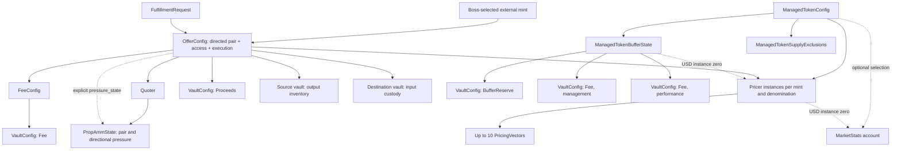

# EVM-aligned Solana model

Status: reusable configuration creation is implemented in
[`instructions/configuration/`](../programs/onreapp/src/instructions/configuration/mod.rs),
using the layouts in [`model/`](../programs/onreapp/src/model/mod.rs).
The first modular execution path, `take_offer`, and boss-authorized
`add_pricer_vector` are described in [`MODULAR_TAKE_OFFER.md`](MODULAR_TAKE_OFFER.md).
V2 account lists and legacy trading behavior stay unchanged. Permissioned and
permissionless NAV execution supports both directions; payouts use only the
selected liquidity vault. Every managed mint uses its per-mint BUFFER when
initialized; ONyc accrues its legacy singleton until a one-way switch makes its
per-mint BUFFER the only active one.
Modular market stats are opt-in per mint. Permissionless Prop AMM execution and
optional buy-side liquidity refill are implemented in
[`MODULAR_PROP_AMM.md`](MODULAR_PROP_AMM.md). Modular BUFFER worker
settlement/settings and market-stats selection are described in
[`MODULAR_TAKE_OFFER.md`](MODULAR_TAKE_OFFER.md#per-mint-buffer). Worker
redemption settlement and custody migration remain deferred.
The legacy runtime remains documented in [`DOMAIN_MODEL.md`](DOMAIN_MODEL.md).

The reference is the current `onre-evm` checkout:
`src/types/OnReTypes.sol`, `src/diamond/LibOnReStorage.sol`,
`src/libraries/OnReIds.sol`, and `docs/OFFER_ARCHITECTURE.md`.
The model follows those domain relationships rather than copying Diamond storage
or ERC-20 token mechanics onto Solana.

Offers explicitly select a compatible Pricer. This differs from EVM's token-derived
offer pricing: multiple Pricer instances may price the same managed mint in the
same denomination, and each offer stores the chosen Pricer's address.

## Relationships

An offer combines reusable components. It does not own vectors, fee policy,
Prop AMM pressure, or BUFFER accounting. Different managed mints have independent
pricing, supply exclusions, issuance limits, and BUFFER state. Governance remains
the existing boss/admin/worker/approver model; Solana program upgrades remain under
the loader upgrade authority, rather than introducing Diamond roles or facets.

## Layout mapping

All accounts use normal Anchor/Borsh serialization, not `repr(C)` or zero-copy.
Field order in each domain module defines the proposed serialized layout. `INIT_SPACE`
excludes the eight-byte account discriminator. There is no implicit padding.

The model is split into `pricer`, `quoter`, `prop_amm`, `fee`, `vault`, `offer`,
`buffer`, `fulfillment`, `managed_token`, and `supply_exclusions` modules. Each module owns its domain's account and supporting types. `model/mod.rs`
re-exports the types, preserving existing `model::Pricer`-style imports alongside
the domain paths such as `model::pricer::Pricer`.

| Account | Body bytes | Allocated bytes with discriminator |
| --- | ---: | ---: |
| ManagedTokenConfig | 115 | 123 |
| Pricer | 443 | 451 |
| Quoter | 11 | 19 |
| PropAmmState | 203 | 211 |
| FeeConfig | 52 | 60 |
| VaultConfig | 44 | 52 |
| ManagedTokenBufferState | 166 | 174 |
| OfferConfig | 335 | 343 |
| FulfillmentRequest | 89 | 97 |
| ManagedTokenSupplyExclusions | 674 | 682 |

| EVM object | Solana model | Contents |
| --- | --- | --- |
| ManagedTokenConfig | ManagedTokenConfig | Managed mint, decimals, enabled, program issuance limits, bump, selected MarketStats account (default = reporting disabled), mint multisig (default = direct PDA minting). |
| PricingVector | PricingVector, embedded | Start/base times, base price, APR, price-step duration. |
| Pricer | Pricer | Instance ID, managed mint, denomination, 10 vector slots, enabled, bump. |
| Quoter | Quoter | Kind, instance ID, enabled, bump. |
| PropAmmState | PropAmmState | Parent quoter, bound asset/managed pair, embedded config, rolling volumes, previous directional net volumes, epoch, buy/sell counts, bump. |
| FeeConfig | FeeConfig | Instance ID, Fee vault reference, basis points, minimum input fee, enabled, bump. |
| ConfigurableVault | VaultConfig | Kind, instance ID, withdrawal destination, refill target, bump. |
| BufferState | ManagedTokenBufferState | Managed mint, three vault references, supply baseline, watermark, accrual time, APR, fee settings, bump. |
| OfferConfig | OfferConfig | Directed mint pair, instance ID, access, execution, direction, pricer/quoter/pressure-state/fee/proceeds/source/destination references, decimals, enabled, bump. |
| FulfillmentRequest | FulfillmentRequest | Offer, user, numeric request ID, gross input, fulfilled gross input, bump. |
| Excluded-supply mappings | ManagedTokenSupplyExclusions | Managed mint, up to 20 token-account addresses, active count, bump. |
| MarketStats | Existing `state::MarketStats` account, selected per mint by `ManagedTokenConfig::market_stats` | APY, circulating supply, NAV, NAV adjustment, TVL, timestamp, slot, bump. |

`VaultConfig` and `ManagedTokenBufferState` deliberately have different Rust names
from the legacy `ConfigurableVault` and `BufferState`. Anchor discriminators are
derived from struct names, not Rust module paths. Reusing those names in another
module would make incompatible account bodies share a discriminator.

An account's existence and ownership replace EVM mapping `exists` flags. The
configurable executable records retain EVM's positive `enabled` polarity:
managed tokens, pricers, quoters, fee configs, and offers. Creation
explicitly enables them. BUFFER existence is optional; Prop AMM configuration
exists when its pair-state account exists. Neither is implied by zero-filled data.

## Account identities

Creation instructions use these identities from `model::seeds`.
Fulfillment requests and supply exclusions remain model-only identities.
Each PDA starts directly with its domain seed; there is no shared prefix.
The concatenated seed layouts are disjoint from legacy layouts and one another,
including when variable seed bytes are arbitrary. Legacy derivations are unchanged.
Pubkey references store the actual component PDA, replacing EVM `bytes32` IDs.
Enum seed values use their one-byte Borsh ordinal;
numeric instance and request IDs use eight-byte little-endian encoding.

| Object | Ordered PDA seeds |
| --- | --- |
| ManagedTokenConfig | `"managed_token", managed_mint` |
| Pricer | `"pricer", managed_mint, denomination, instance_id` |
| Quoter | `"quoter", kind, instance_id` |
| PropAmmState | `"prop_amm", quoter` |
| FeeConfig | `"fee_config", instance_id` |
| Ordinary VaultConfig | `"vault", kind, instance_id` |
| BUFFER reserve VaultConfig | `"buffer_reserve", managed_mint` |
| BUFFER management Fee VaultConfig | `"buffer_management", managed_mint` |
| BUFFER performance Fee VaultConfig | `"buffer_performance", managed_mint` |
| ManagedTokenBufferState | `"buffer", managed_mint` |
| OfferConfig | `"offer_config", token_in_mint, token_out_mint, instance_id` (u64 LE) |
| FulfillmentRequest | `"fulfillment_request", offer_config, user, request_id` (u64 LE) |
| ManagedTokenSupplyExclusions | `"supply_exclusions", managed_mint` |
| Per-mint MarketStats (optional) | `"market_stats", managed_mint` |

BUFFER vaults use token-and-role identities, as in EVM, with instance IDs 0 for
reserve, 1 for management fees, and 2 for performance fees in their account bodies.
Those dedicated identities do not occupy the ordinary vault instance namespace.

Offers are identified by their directed mint pair and a boss-chosen `u64`
`instance_id`, not by mode, so a pair can have any number of offers with the same
or different modes. Its mints, instance ID, access, execution and derived direction are
immutable. The boss replaces component references with `update_offer_config`:
Pricer (any enabled instance of the managed mint), quoter, pressure link, fee
config, proceeds vault and source/destination vaults, revalidated with the same
rules as creation (`validate_offer_components`). `set_offer_pressure_state`
remains for changing the pressure link alone.
Pricer mint, denomination, and instance ID are immutable. Instance zero in USD
remains the canonical token-wide source for BUFFER and MarketStats; an offer may
explicitly choose that instance or another compatible one.

## Creation instructions

Every creation instruction requires the existing `State::boss` signer and charges that
signer rent. Configuration creation remains available while the kill switch is
active, matching the existing governance/configuration policy. `init` rejects
repeat creation; shared accounts are not implicitly initialized or overwritten by
`create_offer_config`.

| Instruction | Behavior |
| --- | --- |
| `register_managed_token` | Registers an existing SPL mint, records decimals, enables it, sets issuance limits to zero. Does not acquire mint authority. |
| `create_pricer` | Creates an enabled instance with zero vectors; `add_pricer_vector` schedules prices. |
| `create_quoter` | Creates enabled dispatch configuration for one kind and instance ID. |
| `create_vault_config` | Creates a vault authority/config with a nonzero destination; creates no ATA. Refill targets are allowed only for Liquidity and cannot exceed 10,000 bps. |
| `create_fee_config` | Requires an existing Fee vault; percentage fees are capped at 1,000 bps and the input-token minimum is stored in base units. |
| `create_prop_amm_state` | Requires an enabled PropAmm quoter, a registered managed mint, and a boss-selected external mint. Validates curve/cadence/epoch settings and creates zero pressure with the current timestamp. Repeat creation cannot rebind the pair. |
| `create_offer_config` | Takes a boss-chosen `instance_id` that, with the mint pair, derives the offer address. Requires exactly one registered managed mint and a Pricer for it. The boss chooses the external mint in the Pricer's denomination. Validates mint decimals, enabled components, mode/quoter compatibility, Prop AMM pair binding, and vault kinds. |
| `set_managed_token_enabled` / `set_pricer_enabled` / `set_quoter_enabled` / `set_fee_config_enabled` / `set_offer_config_enabled` | Boss-only enable/disable of a component (`NoChange` on a no-op, one event per kind). A disabled component fails execution and creation checks that require it; nothing else changes. |
| `update_offer_config` | Boss-only replacement of an offer's Pricer (any enabled instance of its managed mint), quoter, pressure link, fee config, proceeds vault and source/destination vaults with the creation rules. Mints, instance ID, access, execution and direction stay immutable. |
| `update_fee_config` | Boss-only replacement of basis points, minimum fee and Fee-kind vault with the creation rules; instance and enabled flag unchanged. |
| `update_vault_config` | Boss-only replacement of withdrawal destination and refill target with the creation rules; kind and instance unchanged. Also applies to BUFFER vaults, whose destination is the boss at initialization. |
| `update_prop_amm_config` | Boss-only replacement of curve, cadence, epoch and wall settings with the creation limits; the bound pair and accumulated pressure are kept. |
| `unset_managed_token_market_stats` | Boss-only reset of the MarketStats selection to default (reporting disabled); the MarketStats account is untouched. |
| `switch_onyc_buffer_to_per_mint` | Boss-only, one-way: accrues the ONyc legacy singleton BUFFER up to now, has the initialized per-mint BUFFER take over its settings and watermark from the current supply, and makes it the only active ONyc BUFFER. |
| `burn_managed_token_for_nav_increase` | Boss-only burn of per-mint BUFFER reserve tokens that keeps the canonical NAV after removing an asset adjustment; accrues first and refreshes market stats. |
| `refresh_managed_token_market_stats` | Permissionless recomputation of the selected MarketStats (and the ONyc legacy singleton) from current supply and the canonical USD Pricer, between trades. |
| `set_managed_token_mint_limits` | Boss-only per-mint `max_supply` / `max_mint_amount` for program mints; zero disables a limit and a nonzero max supply must cover current supply. ONyc combines them with the global `State` limits (stricter nonzero wins). |
| `enable_managed_token_mint_multisig` / `disable_managed_token_mint_multisig` | Boss-only switch of modular minting between the program PDA and a 1-of-N SPL multisig that includes it; see [MODULAR_TAKE_OFFER.md](MODULAR_TAKE_OFFER.md#minting-authority). |
| `initialize_managed_token_buffer` | Creates independent per-mint accounting and three dedicated vault configs, using the token's enabled USD Pricer instance zero. |

Both SPL Token and Token-2022 mint accounts are accepted through Anchor's token
interface. Managed registration and offer creation allow at most 18 decimals.
Registration is configuration, not a promise that every extension is supported
by settlement. `take_offer` also rejects currently active transfer-fee mints.

Suggested setup order: register managed mints; create Pricer, Quoter,
and vaults; create FeeConfig; initialize Prop AMM state if applicable; then create
OfferConfig. BUFFER initialization is independent of offer creation. Clients may
combine creation instructions in one transaction when transaction limits permit.
There are no new CLI commands yet; generated IDL/types expose these instructions.

### Creation events

Each successful creation emits a typed Anchor `emit!` event. Every payload includes
the authorizing `boss`, the created account's PDA, its complete initial
`configuration` (using the corresponding model account type), and the Unix
`timestamp`. Event definitions live beside their instruction handlers. Snapshots
include defaults, component references, and bumps; Pricer snapshots include its
initial empty vector array. As in legacy Offer, a zero vector start time marks an
empty slot. Pricing operates on nonempty vector data directly through the shared
`utils/pricing.rs` helpers; Pricer stores no separate vector count.
EVM's Pricer stores `vectorCount`; the Solana model uses its existing empty-slot
convention instead.

| Instruction | Event | Created-account field |
| --- | --- | --- |
| `register_managed_token` | `ManagedTokenRegisteredEvent` | `managed_token` |
| `create_pricer` | `PricerCreatedEvent` | `pricer` |
| `create_quoter` | `QuoterCreatedEvent` | `quoter` |
| `create_vault_config` | `VaultConfigCreatedEvent` | `vault` |
| `create_fee_config` | `FeeConfigCreatedEvent` | `fee_config` |
| `create_prop_amm_state` | `PropAmmStateCreatedEvent` | `prop_amm_state` |
| `create_offer_config` | `OfferConfigCreatedEvent` | `offer_config` |
| `initialize_managed_token_buffer` | `ManagedTokenBufferInitializedEvent` | `buffer_state` |

BUFFER initialization emits three `VaultConfigCreatedEvent` records in reserve,
management-fee, performance-fee order, followed by its BUFFER event. All four
share the same boss and timestamp. The BUFFER snapshot records the mint's actual
supply baseline and the three newly created vault addresses.

Consumers must check the transaction's success status before applying events:
logs from an earlier successful instruction can remain visible when a later
instruction fails and rolls back the entire transaction. These are standard
program-log events, subject to RPC log availability and transaction log limits.
Existing instruction accounts and legacy events are unchanged.

## Validation and remaining execution rules

The creation-time rules below are implemented, alongside the first modular execution
path, together with boss-only enable flags and component updates. Other runtime
paths and account closure remain deferred.

Exactly one mint in an offer must be registered as managed. Managed output means
`AssetToManaged`; managed input means `ManagedToAsset`. Both-managed and
neither-managed pairs are invalid. Decimals must match the mint accounts.

On offer creation, the selected Pricer must exist, be enabled, and name the offer's
managed mint. The boss is trusted to select an external asset in the correct
denomination, matching EVM's governance trust model. External assets are not
registered or assigned an on-chain currency classification. The other mint's
canonical managed-registration PDA is checked for empty data to reject
both-managed pairs; neither-managed pairs and self-pairs are also rejected.

Denomination is stored only on the Pricer and read through the offer's explicit
reference. A future Pricer reassignment must match the managed mint and the
currently selected Pricer's denomination before replacing that reference. No
denomination field is duplicated on OfferConfig. Currently only `Usd` is modeled.
Future execution must also check that the selected Pricer remains enabled.
Multiple instances with the same compatible mint and denomination are valid
choices; changing the reference does not change the offer ID.

An offer has two independent modes. `access` decides who may trade:
`Permissioned` users with an approver-signed approval, or `Permissionless` anyone.
`execution` decides how: `Instant` in `take_offer`, or `Worker` through escrowed
fulfillment requests that the worker fills. EVM's single `OfferFlow` enum maps to
(Permissioned, Instant), (Permissionless, Instant) and (Permissioned, Worker);
Solana adds permissionless Worker offers. The shared rule is
`model::quoter_supported`:

| Execution | Access | Direction | Quoter |
| --- | --- | --- | --- |
| Instant | Permissioned | Either | Nav |
| Instant | Permissionless | Either | NavPermissionless or pair-matching PropAmm |
| Worker | Either | ManagedToAsset | Nav |

Each Prop AMM quoter binds one immutable asset/managed pair. Multiple quoters may
bind the same pair with independent parameters and pressure. The two directed
permissionless offers can share one quoter so buys relieve its sell pressure.
NAV kinds may link the same pair state for trade accounting without curve pricing.
Only the exact asset/managed mint pair can link; sharing custody is insufficient.
`set_offer_pressure_state` is boss-only, validates pair and canonical state identity,
and emits old/new references without clearing history. PropAmm cannot detach or
change to another quoter's state. Both directions use the same curve with their
own net directional pressure and cadence. Curve, cadence, epoch duration, and sensitivity
belong together in `PropAmmConfig` inside `PropAmmState`.

FeeConfig references a Fee-kind vault. Every offer references Proceeds and may
independently select source and destination liquidity custody. The source holds
output tokens; the destination holds input tokens. Sells require a source; buys
with a source transfer managed inventory instead of minting. Sells with a
destination retain net managed input instead of burning. NAV buys allow both
absent; PropAmm buys require funded asset destinations for the curve. Each role
supports modular Liquidity, legacy ConfigurableVault or redemption custody.
See [OFFER_VAULT_ROLES.md](OFFER_VAULT_ROLES.md) for the full routing matrix.
NAV offers may also omit the pressure link. The fee
floor is input-token-denominated, so sharing a FeeConfig across different input
mints requires an appropriate policy. EVM's minimum input fee replaces the legacy
Prop AMM-specific minimum ONyc haircut in this target model only.

Vault kinds are `Fee`, `Proceeds`, `Liquidity`, `BufferReserve`, and `Haircut`
(managed tokens retained from Prop AMM sell haircuts). The proposed
physical representation is the vault PDA's ATA per mint; the SPL account balance
is authoritative, replacing the EVM `(vaultId, token)` logical-balance mapping.
Withdrawal destinations are token-account owners; payouts use their ATA for the
selected mint. The implemented withdrawal policy is permissionless for Fee and Proceeds,
and boss-controlled for Liquidity, BufferReserve and Haircut, always to that destination.
Liquidity refill targets live on the Liquidity vault, with zero disabling refill.
Sharing a Liquidity vault across managed tokens also shares actual asset liquidity;
separate instances are needed when each token must have independent liquidity.
An offer may also explicitly reuse a legacy ConfigurableVault and its asset ATA,
without changing its role, withdrawal destination or existing withdrawal policy.
Legacy configurable vaults and the old redemption authority have no modular refill
target. The redemption authority is stateless and validated by its canonical PDA;
its asset ATA can be shared explicitly without migrating funds. New generic and
per-mint BUFFER VaultConfig accounts support
[`deposit_vault_config` and `withdraw_vault_config`](VAULT_CONFIG_OPERATIONS.md).
The shared authority resolver selects each identity's actual PDA seeds.

Each BUFFER record references one BufferReserve vault and two distinct Fee vaults.
Initialization requires that managed mint's canonical USD Pricer instance zero,
independent of any offer's selected price source. The new BUFFER PDA seeds are
`["buffer", managed_mint]`, with token-specific reserve, management-fee,
and performance-fee vault seeds from the table above. Initial `previous_supply`
is the mint's actual supply and `last_accrual_timestamp` is the current timestamp.
Gross APR, both fees, and the high watermark start at zero; the watermark policy
starts enabled. All three vault destinations initially point to the current boss.
Initialization creates no ATAs, moves no funds, and does not accrue or mint.

The legacy `initialize_buffer` and `settle_buffer` still use the singleton
`["buffer_state"]`, `State::onyc_mint`, and legacy vaults. Exactly one ONyc BUFFER
is active: the legacy singleton until the boss's one-way
`switch_onyc_buffer_to_per_mint`, accrued then by modular ONyc execution as well,
and the per-mint BUFFER afterwards (see MODULAR_TAKE_OFFER.md, "ONyc: one active
BUFFER and the one-way switch"). Ordinary mint
and burn paths need explicit supply reconciliation: SPL mints do not provide
the EVM ManagedToken supply-change callback. Issuance limits therefore live in
ManagedTokenConfig and constrain program-controlled paths only.

Worker requests refer directly to their worker OfferConfig; no separate redemption
offer exists in the target model. Each request escrows gross input in its own ATA,
supports partial fulfillment, and resolves current price and fees at each fill.
Its `u64` ID matches EVM; legacy UUID request IDs remain unchanged. The user pays
the request and escrow rent and gets it back when the request closes (fully filled
or cancelled). See MODULAR_TAKE_OFFER.md, "Worker fulfillment requests".

Supply exclusions are explicit SPL token accounts, each unique and holding the
configured managed mint, rather than the legacy owner-to-ATA convention. All
managed-token balances, including BUFFER reserves, count as circulating unless
explicitly excluded. Modular reporting reuses the existing MarketStats account
layout: `ManagedTokenConfig::market_stats` selects one account per mint (unset
disables reporting). ONyc refreshes subtract the existing cached excluded balance;
other mints report full supply until an exclusion cache exists for them.

Amounts and supply use SPL-native `u64`; aggregate Prop AMM volume and TVL use
`u128`. Price uses scale 9; APR/APY use scale 6. TVL is circulating supply ×
NAV / 1e9, in the managed mint's base units (no decimal normalization). Runtime timestamps use signed Solana Unix `i64`; vector
timestamps retain the existing `u64` representation. Arithmetic and conversions
retain checked overflow handling. Modular and legacy Prop AMM share the curve/cadence math and
the fixed-boundary epoch rules. Operational
liquidity targets use TVL in managed-token base units before asset conversion, as
in EVM. NAV execution reuses existing checked pricing, conversion, and BUFFER math.

## Backward compatibility boundary

Legacy account layouts, discriminators, PDA seeds, instruction data, account
ordering, program IDs, vault authorities, and token accounts remain unchanged.
No modular configuration accounts have been created yet; the layouts above define
their initial representation. There is no modular-account migration requirement.
New modular clients use the generated IDL/types. OfferConfig has a 335-byte body,
PropAmmState a 203-byte body, and Pricer a 443-byte body (451 with discriminator).

The existing `take_offer_v2`, `take_offer_permissionless_v2`, `open_swap_buy`, and
`open_swap_sell` paths retain their instruction data and account lists. Their
pricing, fees, custody and mint/burn/BUFFER behavior stays unchanged, alongside
modular execution. They do not resolve the new modular vault
references. Existing clients and accounts for those four paths remain valid.

Later compatibility work must define how legacy instructions resolve the shared
model while keeping existing account lists, custody, and pending claims valid.
The target ATA representation above is not permission to move existing vault funds.
ONyc's per-mint BUFFER has its own baseline, policy, clock and vaults, valued at
the canonical Pricer, and takes over the legacy singleton's policy and watermark at
the one-way switch. Liquidity is scoped
to the vault selected by the offer; old redemption liquidity is not automatically
included. Modular Prop AMM state is independent of the legacy pressure tracker.
Permissionless NAV uses the existing intermediary PDA and its mint-specific ATAs.
Modular Prop AMM, buy-side refill, per-mint BUFFER settlement and worker
fulfillment requests are implemented. CLI changes remain deferred.
